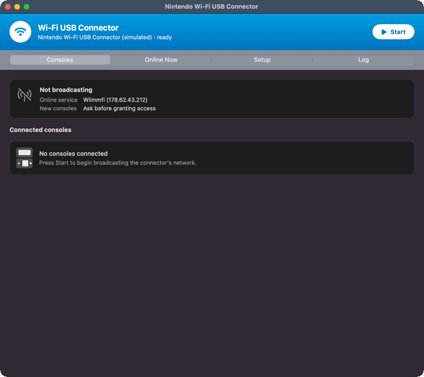
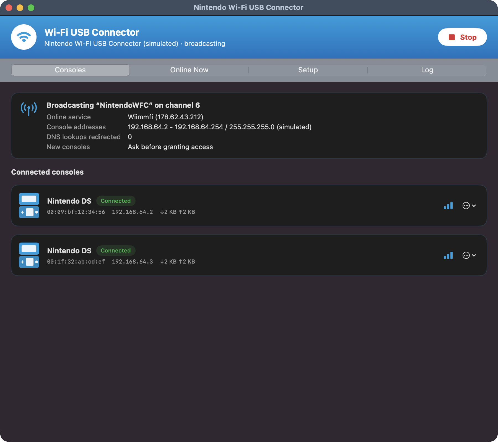
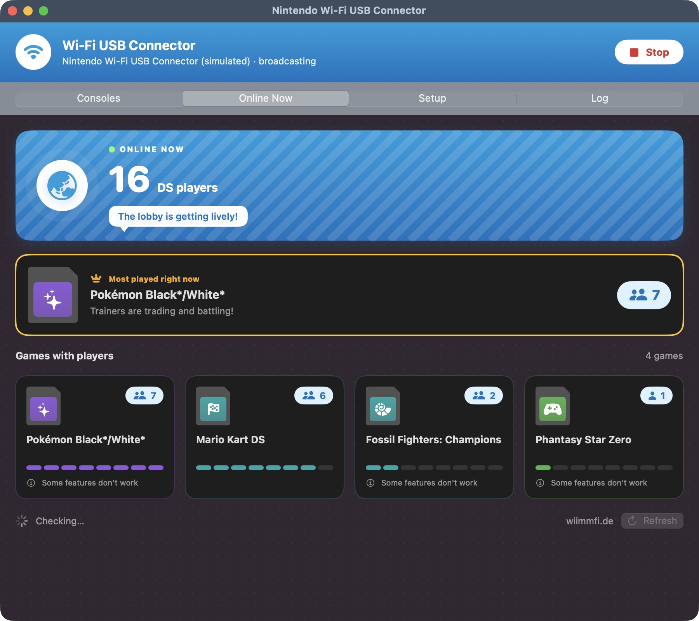
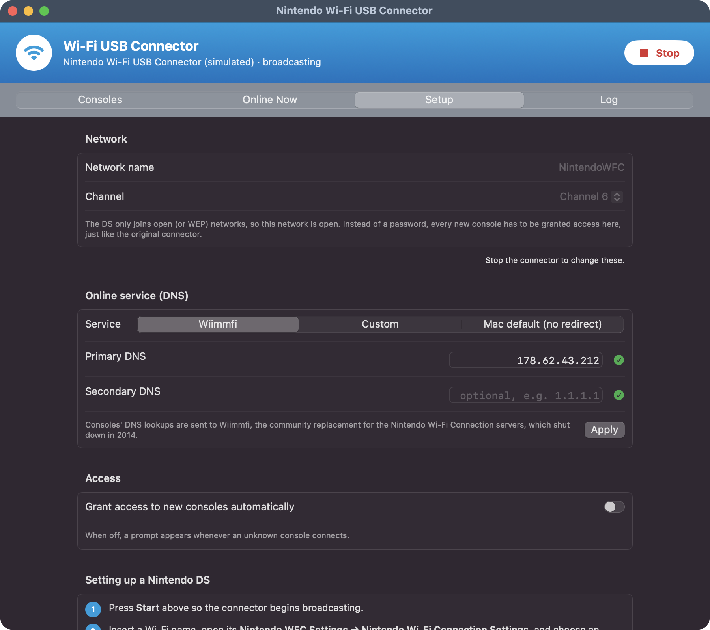

# WFC Connector for macOS

This project brings the Nintendo Wi-Fi USB Connector back to life on a modern Mac. The connector shipped in 2005 with software that only ran on Windows XP. That software no longer works anywhere. This app replaces it.

The app drives the original USB connector directly. It turns the connector into a wireless access point for a Nintendo DS. It shares the Mac's internet connection with the DS. It also points the DS at Wiimmfi, the community server that replaced Nintendo Wi-Fi Connection after Nintendo shut it down in 2014.



## Download

The easiest way to get the app is from the [Releases page](https://github.com/oddnebula/nintendo-wifi-usb-connector-macos/releases/latest). Download the zip, unzip it, and move `WFC Connector.app` to your Applications folder.

The download runs on Macs with Apple silicon (M1 or newer) and macOS 14 or newer. It does not run on Intel Macs. Intel Mac owners can build it from source instead.

The app is not signed by Apple. Because of that, macOS blocks it the first time. To open it, right-click the app and choose **Open**, then click **Open** again. If macOS still blocks it, go to System Settings, then Privacy & Security, and click **Open Anyway**. You only have to do this once.

## Requirements

To begin, you need the original Nintendo Wi-Fi USB Connector (USB ID `0411:008b`). Other adapters with the same Ralink RT2570 chip should also work, but only the Nintendo one has been tested.

## Building from source

Building the app needs the Xcode Command Line Tools and libusb from Homebrew.

```
xcode-select --install
brew install libusb
```

The finished app does not need Homebrew. libusb is built into it.

Run the build script from the project folder.

```
./build.sh
```

The app ends up in `build/WFC Connector.app`.

## Using it

1. Plug in the connector and open the app.
2. Click **Start Helper** and enter your Mac password. The helper needs administrator access to talk to the USB connector and to share the internet connection.
3. Open the **Setup** tab and check the DNS setting. Wiimmfi (`178.62.43.212`) is selected by default. Choose **Custom** to enter a different DNS server.
4. Press **Start**. The light on the connector turns on.
5. On the DS, open Nintendo WFC Settings, pick an empty connection, and choose **Search for an Access Point**. Select `NintendoWFC`.
6. When the DS shows up in the app, click **Grant Access**. The app remembers it after that.
7. Run the connection test on the DS.

Leave the DNS on the DS set to Auto-obtain. The app sends the DNS traffic from the DS to the server in the Setup tab. Nothing needs to be typed on the DS.

## Online Now

The **Online Now** tab shows how many people are playing DS games on Wiimmfi right now. It lists every DS game that has players, with the busiest game at the top. Click a game to open its page on wiimmfi.de. The list refreshes every minute while the tab is open.

This tab works even when the connector is not plugged in.

Wiimmfi does not have a public API, so the app reads the stats page on wiimmfi.de. The site uses a Cloudflare browser check. The app loads the page in a hidden WebKit view, the same engine Safari uses, and the check passes on its own after a few seconds. If Cloudflare ever asks for a click, the app shows a button to open the page in your browser instead.

## Screenshots







The screenshots were taken in demo mode, so the consoles are fake.

## How it works

The project has two parts. The first part is `wfcd`, a helper written in C that runs as root. The second part is the app itself, written in SwiftUI. The two talk over a local socket.

```
 DS ))) USB connector ──USB── wfcd (root) ──vmnet── Mac internet
                                  |
                          WFC Connector.app
```

The helper has four main pieces.

* `rt2570.c` is a driver for the RT2570 chip. It talks to the chip over USB with libusb, so no kernel extension is needed. The register setup comes from the Linux `rt2500usb` driver.
* `ap.c` runs the access point. It answers the DS when it searches, handles the grant and deny list, and holds frames for a DS that is in power saving mode.
* `netutil.c` sends DNS lookups from the DS to the chosen server. It also reads DHCP replies so the app can show the address of each DS.
* `netbridge.c` connects to the internet through vmnet, the macOS feature that virtual machines use. vmnet gives the DS an address and routes its traffic.

The DS only joins open networks or networks using WEP. Because of that, the network is open. The grant list is what keeps other devices off of it.

## Things learned about the hardware

Getting the connector to work took some digging. Three details were not obvious.

* The receiver has to be less sensitive than the Linux driver sets it. At the Linux setting the chip heard so much background noise that it thought the channel was always busy. Sending would stall after a few seconds. The helper now starts the setting at `0x4c` and adjusts it up to `0x58` based on the noise level.
* The light on the connector only turns on when the LED polarity bit is set.
* When sending, the chip wants a rate code from 0 to 3 in its transmit header. It does not want the normal 802.11b rate value.

## Command line

The helper can also run without the app.

```
sudo daemon/wfcd --ssid NintendoWFC --channel 6 --dns 178.62.43.212
daemon/wfcd --no-internet --ssid NintendoWFC
daemon/wfcd --simulate --gui-socket /tmp/wfc.sock
make -C daemon tests
```

The second line runs the radio without internet sharing, which does not need root. The third line runs with fake hardware and fake consoles for testing the app.

## Status

The app works with a real DS. A DS found the network, got access, passed the connection test, and went online through Wiimmfi.

There are a few limits.

* The DS has a setup option named "Nintendo Wi-Fi USB Connector." That option uses a Nintendo protocol that was never documented, so it is not supported. Use Search for an Access Point instead.
* WEP is not supported.
* Some games also need a Wiimmfi patch. See wiimmfi.de for details.

## License

The driver is based on the Linux rt2x00 drivers, which are licensed under the GPL. Because of that, this whole project is released under the GNU General Public License, version 2 or later. See `LICENSE` for the full text.

This project is not affiliated with or endorsed by Nintendo. Nintendo DS and Nintendo Wi-Fi Connection are trademarks of Nintendo.
